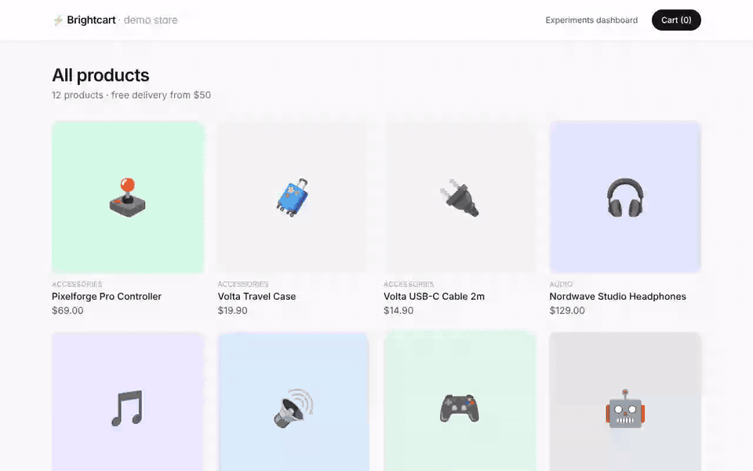
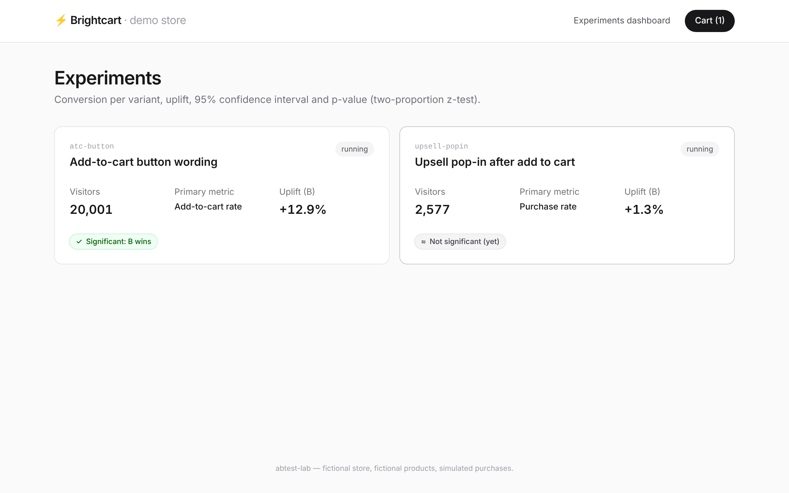
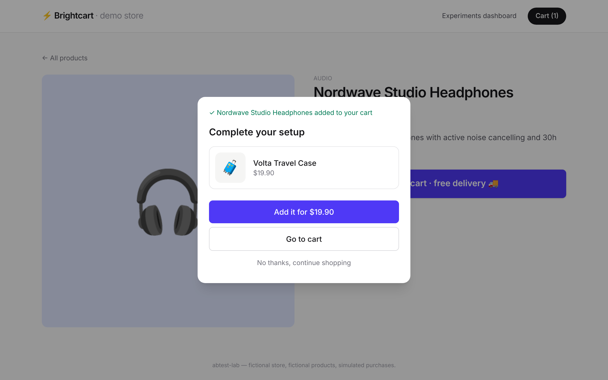
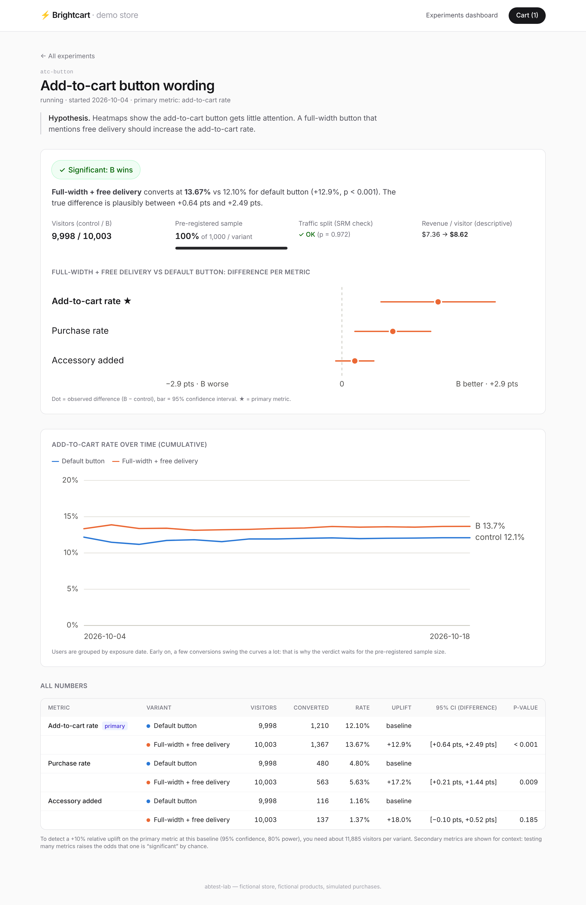
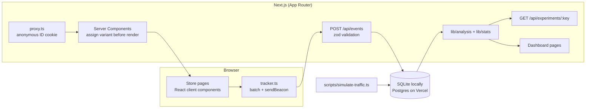

# abtest-lab

[](https://github.com/Melvin2209/abtest-lab/actions/workflows/ci.yml)


**A small, end-to-end A/B testing platform for a demo e-commerce store.**
Visitors are assigned to variants server-side with a deterministic hash, their behaviour is tracked through a validated REST API,
and a dashboard tells you, with a two-proportion z-test, confidence intervals and a sample-ratio check, whether variant B actually wins.



| Results dashboard                                        | Variant B in the store (upsell pop-in)                      |
| -------------------------------------------------------- | ----------------------------------------------------------- |
|  |  |

<details>
<summary>Full experiment page</summary>



</details>

---

## What it does

The whole experimentation loop, from hypothesis to decision, in one repository:

1. **Hypothesis.** Each experiment stores its hypothesis, its primary metric and a sample size fixed in advance.
2. **Implementation.** Two experiments run in the store (a fictional electronics shop):
   - `atc-button`: default add-to-cart button vs. a full-width button that mentions free delivery.
   - `upsell-popin`: simple "added to cart" message vs. a pop-in suggesting an accessory.
3. **Assignment.** A deterministic hash of `experimentKey:visitorId` gives a stable variant. The split is configurable (50/50, 90/10…).
4. **Tracking.** Exposures, clicks, add-to-carts and simulated purchases are batched by a small client tracker and sent to `POST /api/events`.
5. **Analysis.** For each variant the dashboard shows conversion rates, uplift, the 95% CI of the difference, the p-value, an SRM check and a plain-English verdict.
6. **Traffic simulation.** A seeded script generates 20,000 realistic visitors with _known_ true effects, so you can check the analysis against the truth.

## Architecture



```
src/
├── proxy.ts                 # sets the anonymous visitor cookie (Next 16's "middleware")
├── lib/
│   ├── assignment.ts        # FNV-1a hash -> bucket -> weighted variant
│   ├── experiments.ts       # loads experiments, assigns the current visitor
│   ├── events.ts            # event schema (zod) + recordEvents (dedup of exposures)
│   ├── tracker.ts           # client-side batching tracker
│   ├── analysis.ts          # SQL per exposed user + pure aggregation
│   └── stats.ts             # z-test, CI, SRM, sample size, verdict
├── app/
│   ├── page.tsx, product/[id], cart, checkout     # the demo store
│   ├── dashboard/, dashboard/[key]                 # results
│   └── api/events, api/experiments[/:key]          # REST API
└── components/              # store + dashboard components (charts are plain SVG)
scripts/
├── simulate-traffic.ts      # seeded traffic generator
└── simulation.ts            # behaviour model with known true effects
e2e/                         # Playwright tests
prisma/schema.prisma         # Product, Experiment, Variant, Exposure, Event
```

### Data model

- **Experiment / Variant**: configuration (key, hypothesis, primary metric, status, pre-registered sample size, variant weights).
- **Exposure**: one row per `(experiment, user)`, recording the _first_ time a user actually saw the tested element.
- **Event**: raw behavioural events (`click`, `add_to_cart`, `purchase`), not tied to an experiment. The analysis joins them to exposures by user, so one purchase can count for several experiments.

## Run it locally

Requirements: Node.js ≥ 20.19 and npm.

```bash
git clone https://github.com/Melvin2209/abtest-lab.git
cd abtest-lab
npm install                 # also generates the Prisma client
cp .env.example .env        # optional: defaults to a local SQLite file
npm run db:setup            # creates dev.db and seeds products + experiments
npm run simulate            # 20,000 simulated visitors over 14 days (~40 s)
npm run dev                 # http://localhost:3000
```

Open the store at `/`, the dashboard at `/dashboard`. To browse as a specific visitor, delete the `abl_uid` cookie (you get a new random ID) or set it to `demo-12`, which lands in variant B of both tests.

| Script                                                    | What it does                                                |
| --------------------------------------------------------- | ----------------------------------------------------------- |
| `npm run dev` / `build` / `start`                         | Next.js                                                     |
| `npm test`                                                | Vitest unit + integration tests (on a throwaway `test.db`)  |
| `npm run test:e2e`                                        | Playwright, against a production build and a fresh `e2e.db` |
| `npm run lint` / `typecheck` / `format`                   | ESLint (0 warnings allowed), `tsc --noEmit`, Prettier       |
| `npm run db:setup`                                        | Create the SQLite schema and seed it                        |
| `npm run simulate -- --visitors 30000 --days 21 --seed 7` | Regenerate traffic (wipes existing events)                  |

## How it works

### 1. Variant assignment ([`src/lib/assignment.ts`](src/lib/assignment.ts))

```
bucket  = FNV-1a("atc-button:" + visitorId) mod 10,000      -> 0..9999
variant = first variant whose cumulative weight covers bucket   (control = 0..4999, B = 5000..9999 for 50/50)
```

- **Stable without storage.** The same visitor always hashes to the same bucket.
- **Independent across experiments.** The experiment key is part of the hash, so being in B for one test says nothing about another (there's a test for this).
- **Server-side, before render.** `proxy.ts` creates the visitor ID on the very first request and forwards it to that same render. The page is then rendered directly in the right variant. There is no flicker, unlike client-side tools that swap the DOM after load.
- **Variant order is fixed** (control first), so the mapping never depends on the order rows come back from the database.

### 2. Tracking ([`src/lib/tracker.ts`](src/lib/tracker.ts), [`src/app/api/events/route.ts`](src/app/api/events/route.ts))

- Events are queued and sent in batches. They are flushed with `navigator.sendBeacon` when the page is hidden, so they survive navigation. Purchases are sent immediately.
- The API validates every batch with **zod** (types, positive integer amounts, max 50 events).
- **The client is not trusted.** The user ID comes from the httpOnly cookie, and the variant of an exposure is **recomputed on the server**. A client cannot log an exposure to a variant it was not assigned.
- **Exposures are deduplicated** with a unique `(experimentKey, userId)` constraint, and only the first exposure is kept.
- **Triggered exposure** for the pop-in test: both groups are counted as exposed at the moment they add to cart, which is when the experiences start to differ. Counting every product-page visitor would dilute the effect with people who never reached the pop-in.

### 3. Analysis ([`src/lib/analysis.ts`](src/lib/analysis.ts))

One SQL query returns one row per exposed user with flags such as "added to cart after exposure" and "purchased after exposure". Only events **after** the exposure count: a purchase made before seeing the variant cannot have been caused by it. The SQL is portable (quoted identifiers and `CASE`/`MAX` only) and was tested on both SQLite and Postgres 16. Everything else is pure, unit-tested TypeScript.

## The statistics, explained

All the math lives in [`src/lib/stats.ts`](src/lib/stats.ts), commented line by line, and is checked against **statsmodels / scipy** reference values in [`stats.test.ts`](src/lib/stats.test.ts).

Each visitor either converts or not, so a conversion rate is a proportion: $\hat p = \frac{\text{conversions}}{\text{visitors}}$.

**Two-proportion z-test.** The question is: if A and B truly converted at the same rate, how surprising would the observed gap be?

$$
\hat p_{pool} = \frac{x_A + x_B}{n_A + n_B} \qquad
SE_{pool} = \sqrt{\hat p_{pool}(1-\hat p_{pool})\left(\tfrac{1}{n_A} + \tfrac{1}{n_B}\right)} \qquad
z = \frac{\hat p_B - \hat p_A}{SE_{pool}}
$$

The **p-value** is $2\,(1 - \Phi(|z|))$: the probability of a gap at least this large, in either direction, if there were no real difference. $\Phi$ (the normal CDF) is computed with the Abramowitz–Stegun approximation of `erf`.

**95% confidence interval** of the difference. Here we do not assume A = B, so each group keeps its own variance:

$$
(\hat p_B - \hat p_A) \pm 1.96\,\sqrt{\tfrac{\hat p_A(1-\hat p_A)}{n_A} + \tfrac{\hat p_B(1-\hat p_B)}{n_B}}
$$

If the interval contains 0, "no difference" is still plausible. The **relative uplift** is $(\hat p_B - \hat p_A)/\hat p_A$.

**Verdict**, in this order:

1. **SRM (sample ratio mismatch).** A chi-square test compares the observed split with the configured weights. A 50/50 test that ends at 53/47 on 10,000 users is broken (a bug, lost tracking, bots), so nothing else is trusted (threshold p < 0.001).
2. **Pre-registered sample size.** There is no verdict before each variant reaches the sample fixed in advance. Checking every day and stopping at the first p < 0.05 ("peeking") inflates false positives well above 5%.
3. **p < 0.05**: "Significant: B wins / loses". Otherwise "Not significant (yet)".

**Sample size.** The dashboard also shows how many visitors per variant you need to detect a +10% relative uplift with 80% power:

$$
n = \frac{(z_{1-\alpha/2} + z_{1-\beta})^2\,\big(p_A(1-p_A) + p_B(1-p_B)\big)}{(p_B - p_A)^2}
$$

At a 10% baseline that is about 14,750 visitors per variant. This is why small effects need a lot of traffic.

### What the demo data shows

The simulator's true effects are known: `atc-button` B is **+15%** on add to cart, while the pop-in has **no real effect** on purchases but drives accessory adds. With the default seed:

| Experiment     | Primary metric | Control | B      | Uplift | 95% CI (difference) | p       | Verdict         |
| -------------- | -------------- | ------- | ------ | ------ | ------------------- | ------- | --------------- |
| `atc-button`   | Add to cart    | 12.10%  | 13.67% | +12.9% | [+0.64, +2.49] pts  | < 0.001 | B wins          |
| `upsell-popin` | Purchase       | 40.22%  | 40.73% | +1.3%  | [−3.27, +4.31] pts  | 0.79    | Not significant |

For the pop-in, the secondary metric "accessory added" goes from 3.8% to 15.9% (p < 0.001). The pop-in works for accessories, and we have no evidence that it hurts purchases. With ~1,300 users per variant, though, the test could only detect large effects on purchases. The dashboard says so instead of declaring a winner.

> **A lesson from building this:** with `--seed 42`, the `atc-button` test shows **+30%** for a true effect of +15%. Its 95% CI doesn't even contain the true value. That's not a bug (I checked across 30 seeds: no bias). It is the 1-in-20 case that a 95% interval allows, and a good reminder that a single significant test tends to _overestimate_ the effect (the "winner's curse").

## Technical choices and trade-offs

- **Next.js App Router + Server Components** for server-side assignment without flicker. The route handlers act as a small BFF with no separate backend to deploy.
- **Prisma 7 with driver adapters.** `better-sqlite3` locally and `pg` in production, picked from `DATABASE_URL`. The schema avoids provider-specific features, and `scripts/set-db-provider.mjs` switches the provider at build time on Vercel.
- **Plain SVG charts** instead of a chart library. They are small, and every pixel can be explained. The two series colors were checked for color-blind separation, every chart has a legend, direct labels and a table view.
- **Raw SQL for the analysis.** It is the one place where a join with a time condition is clearer in SQL than in an ORM.
- **Tests on a real SQLite database** for the storage and analysis layers rather than mocks, so the SQL itself is tested.

## Limitations and next steps

- **Fixed-horizon frequentist test only.** It doesn't handle continuous monitoring. Sequential testing (e.g. mSPRT) or a Bayesian approach would make peeking safe.
- **No multiple-testing correction.** Secondary metrics are shown for context, not for decisions. Bonferroni or Holm would be the next step.
- **Revenue per visitor is descriptive only.** Testing it needs a t-test or bootstrap, since revenue is not a proportion.
- **Aggregation happens in the app.** It loads one row per exposed user. That is fine for tens of thousands of users, but at scale it belongs in SQL or a warehouse, with pre-aggregated daily tables.
- **No admin UI.** Experiments are created through the seed. Changing weights mid-test would reassign some users, so a real platform would freeze them once an experiment starts.
- **No consent banner or bot filtering.** A real store would need both before tracking anyone.
- **`prisma db push` instead of migrations**, to keep the SQLite/Postgres switch simple. A production app would use versioned migrations.

## Deploy to Vercel

1. **Create a Postgres database.** In the Vercel dashboard, open _Storage → Create Database → Neon_ (free tier), or use any Postgres provider. Connect it to the project so that `DATABASE_URL` is set for _Production_ and _Preview_.
2. **Import the repository** in Vercel (_Add New → Project → Melvin2209/abtest-lab_). Framework preset: Next.js.
3. **Set the build command** to `npm run vercel-build` (_Settings → Build and Deployment_). This script:
   - switches the Prisma provider to `postgresql`;
   - generates the client;
   - syncs the schema (`prisma db push`, which refuses destructive changes);
   - seeds the experiments (idempotent);
   - runs `next build`.
4. **Deploy.** The store and an empty dashboard are live.
5. **(Optional) Fill the dashboard** from your machine:
   ```bash
   DATABASE_URL="postgresql://…" npm run simulate -- --visitors 20000
   ```
   This is slower over the network, so allow a few minutes. Real visits then add to the simulated data.

See [`.env.example`](.env.example) for the variables.

## Tests and CI

- **64 unit and integration tests (Vitest)** cover:
  - the hash test vectors, stability, the 50/50 and 90/10 splits, and independence across experiments;
  - every statistic against statsmodels/scipy;
  - the event validation and deduplication;
  - the SQL analysis on a real database;
  - the simulator.
- **End-to-end tests (Playwright)** run against a production build:
  - the control and B journeys;
  - assignment stability across reloads;
  - events travelling from the browser to the results API and the dashboard;
  - API validation.
- **GitHub Actions** runs format check, lint, typecheck and unit tests in one job, and the Playwright suite in another.

Screenshots and the GIF are reproducible with `node scripts/capture-screenshots.mjs` (needs a running production build, and ffmpeg for the GIF).

## License

MIT. The store, brands and products are fictional, and purchases are simulated.
